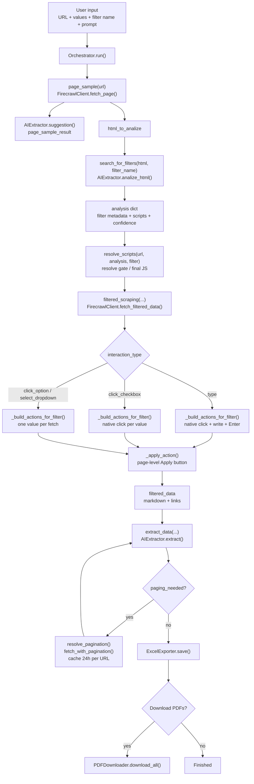

# AI-Powered Web Scraping Pipeline

This repository is a prototype for scraping dynamic product catalog pages using a mix of:

- browser automation with Firecrawl
- AI-based page understanding with Gemini
- JavaScript-driven filter and pagination handling
- Excel export and optional PDF datasheet download

It is designed for catalog-like websites where the product list is rendered dynamically and the filter UI is not simple static HTML. Typical examples are electronics distributor pages and parametric search grids.

Important: this project is still an experimental automation pipeline, not a polished production-ready product. Some changes are needed before general use.

---

## Overview

### What this project solves

This system automates data extraction from complex, JavaScript-heavy product catalog websites where:
- Product lists are rendered dynamically
- Filters use custom UI (dropdowns, search boxes, checkboxes, AG Grid, React controls)
- Navigation requires JavaScript interaction
- Static HTML scrapers fail

### Typical use cases

- Electronics distributor sites (Texas Instruments, Infineon, Analog Devices)
- Parametric search grids with many filter types
- Sites with pagination or lazy-loading
- Product comparison pages
- DataSheet collection and export

### What it does

The system takes a website URL, a list of product identifiers (part numbers), and a data extraction prompt, then:

1. Analyzes the page structure with AI
2. Locates and understands the filter UI
3. Generates JavaScript to interact with filters
4. Filters products one by one
5. Extracts structured records with AI
6. Handles pagination
7. Exports results to Excel
8. Optionally downloads datasheets (PDFs)

---

## Quick Start

### Prerequisites

- **Python 3.8+** (3.9+ recommended, 3.11+ preferred)
- Firecrawl API key: https://www.firecrawl.dev/
- Google Gemini API key: https://aistudio.google.com/apikey

### Setup (5 minutes)

```bash
# 1. Clone and enter directory
cd ai-powered-web-scraping

# 2. Create virtual environment
python -m venv .venv
source .venv/bin/activate  # Windows: .venv\Scripts\activate

# 3. Install dependencies
pip install -r requirements.txt

# 4. Configure credentials
cp .env.example .env
# Edit .env and add your API keys:
#   FIRECRAWL_API_KEY=your_key_here
#   GEMINI_API_KEY=your_key_here

# 5. Run
python src/main.py
```

### Test with example sites

Interactive test suite with pre-configured sites:

```bash
python src/test_orchestrator.py
```

Pick a site by number. Each entry carries its own URL, filters and extraction prompt.

#### What a healthy run looks like

Verified on 2026-09-29, every test green in one sweep:

| # | Site | Records | Notes |
|---|------|---------|-------|
| 1 | Texas Instruments - sensors | 14 | 7 requested values; `TMP75` alone returns 6 variants, `ISO` returns the ISOTMP35 family |
| 2 | Analog Devices - parametric search | 58 | |
| 3 | Vishay - LEDs SMD | 3 | |
| 4 | Infineon - digital isolators | 4 | |
| 5 | KOA Speer | 2 | |
| 6 | Samtec - multi-filter | 1 | |
| 7 | Amphenol | 3 | no product table on the page - records come from link tiles and carry no part number |
| 8 | TE Connectivity - power connectors | 2 | |
| 9 | Molex1 | 44 | 5 pages of 10, the last one partial - a good check that pagination completes |
| 10 | Molex2 - multi-filter | 6 | `Component Type: Receptacle`; the same run without that filter returns 10 (6 receptacles + 4 plugs) |

These are live manufacturer catalogs, so the counts can legitimately move when a manufacturer adds
or retires parts. Treat a mismatch as a reason to read the log, not as proof of a bug - and check
the warnings first: `the result is incomplete` means the model dropped a page (usually a 503), and
`these filters were NOT applied` means the run was wider than you asked for.

### Debug output

Both clients take a `debug` flag, and `Orchestrator` passes it down:

```python
Orchestrator(debug=True)     # action dumps, model responses, retry chatter
Orchestrator()               # quiet - warnings only
```

`run_debug()` turns the flag on by itself, so the interactive test suite is always verbose.
A production run through `main.py` stays quiet, but never silent: anything that costs you
records is printed as a `WARNING` regardless of the flag - an unmatched filter value, a page
the model gave up on, a paginated page that came back unchanged, a script that threw in the
browser. If a run ends with fewer records than expected, those lines are the first place to look.

---

## Architecture

### How the application works

The flow is orchestrated by `Orchestrator`. Here's what happens:



#### 1. Page reconnaissance

Fetch the page and ask AI: What fields exist? Which are filterable? Does pagination exist?

```
page_sample() → AI analysis → field detection
```

#### 2. Filter discovery

Find the correct filter element for the user's chosen field.

**Challenge:** Filters vary widely (custom boxes, dropdowns, checkboxes, AG Grid, React inputs, hidden elements).

#### 3. Script resolution

Generate JavaScript that:
- Opens the filter
- Types a value
- Selects an option
- Triggers page reload
- Waits for data

```
resolve_scripts() → generated JS snippets → tested against DOM
```

**Fragility point:** JS must work against actual target page structure.

#### 4. Filtered data fetch

Apply resolved logic to each product in the user's list.

```
filtered_scraping() → one value at a time → capture result
```

#### 5. Record extraction

Send page markdown to Gemini and ask for structured data extraction.

```
extract_data() → AI parsing → structured JSON records
```

#### 6. Pagination

If more pages exist, loop until all results collected.

**Weakness:** Many sites implement pagination uniquely.

#### 7. Export

Save to Excel via `ExcelExporter`. Optionally download PDFs with `PDFDownloader`.

### Key modules

| Module | Purpose |
|--------|---------|
| `orchestrator.py` | Main orchestration loop; coordinates all steps |
| `firecrawl_client.py` | Browser automation; page fetching and JS execution |
| `ai_extractor.py` | Gemini prompts; page analysis, filter detection, data extraction |
| `excel_exporter.py` | Generate Excel files from extracted records |
| `pdf_downloader.py` | Download datasheets for matched products |

### Script rewriters

The model writes the JavaScript, but it is not shipped to the browser as written. Every snippet
goes through `_safe_script()` in `firecrawl_client.py`, which wraps it in try/catch (so a broken
script reports itself instead of killing the run) and rewrites the patterns the model gets wrong
often enough to be worth automating:

| Rewriter | What it fixes |
|----------|---------------|
| `_use_native_setter()` | `el.value = x` is swallowed by React/Vue controlled inputs - rewritten into a call to the prototype's native setter, which is where the framework reads from |
| `_real_submit()` | `form.dispatchEvent(new Event('submit'))` runs the handlers but never submits - rewritten to `requestSubmit()` |
| `_confirm_with_enter()` | a synthetic `input` event is not a keystroke - appends keydown/keyup Enter when the script types but never confirms |
| `_scoped_apply_script()` | Apply buttons come in twins (one per filter panel plus a page-level one) - picks the visible one whose nearest checkbox-bearing ancestor holds the most of them |
| `_advancing_next_script()` | a next-page control selected by an attribute holding a page number only works once - resolves the current page from the DOM at click time and takes the one after it |
| `_confirm_with_button()` | a field inside a shadow root is confirmed by the component's own button, which the fetched HTML never shows - finds it in the live page and clicks it, but only when the script types and confirms nothing |

### Repairs on the model's answer

The same idea runs one level up, in `orchestrator.py`: the model proposes, the HTML decides.
Each of these fires only when the page disagrees with the answer, so a correct answer passes
through untouched.

| Repair | What it catches |
|--------|-----------------|
| `_drop_invented_selectors()` | a selector that matches nothing, or matches several elements - a native click takes the first match, so an ambiguous gate opens the wrong column's menu |
| `_repair_gate_selector()` | a grid puts the header and its filter button in different rows, so scoping by the header alone hits nothing - rebuilds the selector around the column attribute both rows share |
| `_complete_missing_options()` | long option lists come back truncated - rebuilds a requested value from the id family its listed twins belong to |
| `_repair_facet_choice()` | HTML windows are picked by search term, so a filter called `Type` also matches the `Component Type` panel - takes the panel whose heading *is* the filter name |
| `_script_targets_disabled()` | grids ship one filter input per column and leave them disabled until the menu opens - typing into one fails silently, so it counts as no control at all |
| `_is_closed_select_option()` | an `<option>` of a plain `<select>` is not natively clickable - falls back to the script |

Where a selector exists, the action is a native `click` rather than a scripted one: AG Grid menus
and some frameworks ignore `element.click()` from `executeJavascript` but honour a real browser
click. The exception is an `<option>` of a plain closed `<select>`, which is not natively
clickable - `_is_closed_select_option()` in `orchestrator.py` detects that case and falls back
to the script.

### Typical flow in the interactive app

When the app is used interactively, the expected sequence is:

1. Paste a catalog URL
2. Review the page summary (AI-generated)
3. Provide product values (part numbers) manually or from CSV/TXT/XLSX file
4. Choose the field to filter by (e.g., `Product number`)
5. Optionally add hints for ambiguous field names (e.g., `part number`, `filter by product`)
6. Describe which product attributes to extract (custom prompt)
7. Choose an output file path
8. Decide whether to download datasheets

**Example:**

Product list:
```text
TMP75, TMP117, ISOTMP35
```

Filter configuration:
- Field: `Product number`
- Hint 1: `part number`
- Hint 2: `filter by product`

The app then locates the filter, generates interaction JavaScript, applies filters one by one, extracts records, and exports to Excel.

---

## Developers: Navigating this repo

### Where to start reading

**If you're new, read in this order:**

1. **`src/orchestrator.py`** — Main loop and overall flow
2. **`src/firecrawl_client.py`** — Browser automation and page fetching
3. **`src/ai_extractor.py`** — AI prompts and parsing logic
4. **`src/excel_exporter.py`** — Excel output
5. **`src/pdf_downloader.py`** — PDF downloads

### Directory layout

```
src/                      # Main application code
  orchestrator.py         # Orchestration layer
  firecrawl_client.py     # Browser automation
  ai_extractor.py         # AI-based understanding
  excel_exporter.py       # Excel export
  pdf_downloader.py       # PDF downloads
  main.py                 # Entry point
  test_orchestrator.py    # Interactive test suite

tests/
  manual_tests/           # Development test runners
  older_code/             # Legacy site-specific scrapers (reference only)

data/                     # Generated during runtime (ignored by git)
  docs/                   # Developer guide
  excel/                  # Output Excel files
  datasheets/             # Downloaded PDF datasheets
  resolved_pagination/    # Cached pagination scripts, 24h per URL

.env.example              # Template for credentials
requirements.txt          # Pinned dependency versions
```

### Note on data/ directory

- **Ignored in `.gitignore`** — Not included in repository
- **Auto-created** — Directory created when app first runs
- **Contains:** Debug dumps, cached results, test files, generated Excel files
- **Not shipped** — Cloned projects won't have this directory initially

### Note on tests/older_code/

Legacy code from earlier project iterations:
- Original `ProductFinder` class (Texas Instruments specific)
- Site-specific scraper logic
- **Why kept:** Reference material for project evolution
- **Why not used:** Logic now generalized via `Orchestrator` and AI extraction
- **Not imported:** These files are not part of the current pipeline

---

## Developers: Contributing to this project

### Before you change anything, understand these principles

#### 1. AI output must be validated

Never trust AI output blindly. Always validate extracted data and selector choices.

#### 2. Generated JavaScript must be scoped

JS snippets must be carefully scoped to avoid DOM collisions and side effects.

#### 3. Avoid generic CSS selectors

Don't rely only on repeated CSS classes (e.g., `.product-row`). Combine with unique attributes, text content, or structure.

#### 4. React inputs need workarounds

React-controlled inputs often reject plain value assignment. They need event simulation.

#### 5. Site structure varies widely

Pagination, filter UI, and record layout differ per site. Some site-specific logic is unavoidable.

#### 6. Handle API limits and flakes

Firecrawl and Gemini APIs have rate limits. Browser behavior can be flaky. Use retries, backoff, and timeouts.

### Performance expectations

- Page analysis: **50–60 seconds**
- Per-record filtering: **15–55 seconds** (depends on DOM complexity)
- Record extraction: **20–70 seconds** (depends on count and complexity, for each record with multiple response records or pages you should expect + 30s minutes per record)

---

## Best way to debug this repo

When a page fails, the most effective debugging flow is:

1. **Save intermediate files** — Check `data/` directory for HTML/markdown dumps. Inspect them or view elements in browser.
2. **Verify filter presence** — Confirm the filter element exists and is visible on the page.
3. **Inspect orchestrator step** — Find which step failed (page reconnaissance, filter discovery, script resolution, etc.).
4. **Test generated JavaScript** — Verify if the generated JS snippet is valid in the browser console.
5. **Validate AI output** — Check the structure of extracted data before trusting it.

**Remember:** Many failures are not Python exceptions. They're DOM issues caused by dynamic websites, hidden elements, or JavaScript state problems.

---

## Working with the free Gemini tier

The pipeline is built around the free Gemini tier, and that tier is the single largest source
of noise in a run. Expect this:

- **503 `UNAVAILABLE` comes in bursts.** Every call retries with exponential backoff and jitter
  (`RETRY_ATTEMPTS = 5`, starting at 4s). Most bursts clear inside two retries.
- **Don't trust results from the afternoon.** In practice the API degrades sharply after ~13:00
  local time, and there have been days when nothing went through from 15:00 onwards. A test that
  fails at 16:00 usually tells you nothing about your code. Schedule real test runs for the morning.
- **A page the model never answers for is not an empty page.** When retries run out, the extractor
  returns an empty result with `unavailable: True`, the orchestrator counts it, and the run ends
  with `WARNING: the result is incomplete - N page(s) could not be read`. Check that line before
  concluding that a filter or pagination is broken.
- **A truncated JSON reply is retried like a 503**, because the model rarely cuts off twice in a row.

### Staying inside the quota

Every model call goes through `AIExtractor._generate()`, which is the only place that talks to
Gemini. Before a call it holds the request back if the last 60 seconds have already used up the
per-minute budget, and after a call it records what the request actually cost. Waiting a few
seconds is cheaper than a 429, which costs a fixed minute.

The limits live at the top of `ai_extractor.py`:

```python
REQUESTS_PER_MINUTE = 15
TOKENS_PER_MINUTE = 250_000
REQUESTS_PER_DAY = 500
```

These are the free-tier numbers for `gemini-3.1-flash-lite`. Google does not publish them in the
docs any more - a key's real limits are shown in AI Studio under **Rate limits**, so check there
after changing model or tier and set these three accordingly.

The daily count is kept in `data/gemini_usage.json`, not in memory, because every run is a new
process and an in-memory counter would never reach a daily limit. The file holds one date and one
number, and resets itself when the date changes. Crossing 50% and 90% of the daily budget prints a
warning once - not once per run, since the count is read back from the file. Past 100% the pipeline
keeps going and lets the existing 429 handling deal with it.

Note that this counter resets on the machine's local date, which is not necessarily the moment
Google resets the quota - treat it as a warning system, not as an authority.

Firecrawl has hard limits of its own that shape the pagination loop: **50 actions** and
**60 seconds of total wait time** per scrape. Both are budgeted in `fetch_with_pagination()`,
so a long run silently collects fewer cycles rather than failing the request.

---

## Known Limitations

### 1. Filtering is not fully general

✗ Works on many sites, but not all catalog grids  
✗ Some logic remains site-specific  
✓ Covers most common filter types (dropdowns, search, checkboxes)

### 2. AI selectors aren't deterministic

The model may occasionally pick a stale or incorrect selector. This is a top quality issue.

### 3. Pages without product tables are not a good fit

✗ The scraper struggles on sites where products are shown as links, images, cards, or other non-tabular layouts instead of a clear product table/grid
✗ If records are not exposed as structured rows, the script cannot reliably detect and filter them
✓ This works best when the page shows product entries in a repeatable table or grid-like structure

### 4. Pagination is unreliable on some sites

✗ Virtualized grids, hidden counters, custom navigation still need debugging  
✗ No universal pagination pattern exists

### 5. Specialized filters missing

✗ Range sliders  
✗ Date pickers  
✗ Complex multi-select patterns

### 6. PDF download depends on site

Not all sites provide datasheet URLs. Extraction accuracy varies.

---

## Dependencies and versions

| Package | Version | Purpose |
|---------|---------|----------|
| firecrawl-py | 4.32.0 | Browser automation and web scraping |
| beautifulsoup4 | 4.15.0 | HTML parsing and element selection |
| google-genai | 2.11.0 | Google Gemini API client |
| openpyxl | 3.1.5 | Excel file generation and export |
| markdownify | 1.2.3 | Convert HTML to Markdown |
| requests | 2.34.2 | HTTP requests and API calls |
| python-dotenv | 1.2.2 | Load environment variables from `.env` |

All versions are pinned for reproducible builds. To update:

```bash
pip list --outdated
```

---

## Roadmap: What still needs to be developed

### High priority

1. **Generalize multi-filter support**
   - Currently the pipeline is built around a single filter field per run
   - Needs a flexible architecture that accepts an arbitrary number of filters at once (any combination of fields/values), not just one

2. **Support link-based pages, not only tabular grids**
   - Some catalog pages aren't table/grid based - product data or datasheet links live in a different structure (card lists, detail-page links)
   - Extraction logic currently assumes a tabular/grid layout; needs a second mode for link-based pages

3. **Treat the page's own search box as a filter**
   - Nearly every catalog carries a free-text search field, and it often reaches values no facet
     exposes: part fragments, series names, keywords that span several columns
   - The pipeline only resolves declared filter controls, so that field is currently invisible to it
   - Offering it as one more filter would give the user a way through pages whose facets are poor,
     missing, or too coarse - on some sites it is the only control that narrows anything useful

4. **Generalize filter logic**
   - Support more filter types
   - Improve selector reliability

5. **Improve pagination**
   - Detect page counts reliably (the model does not always return `filtered_page_count`,
     and the loop then pages blind up to the action/time budget)
   - Support virtualized grids
   - Stop clicking into a next control that is already exhausted. **Deliberately not done**, and
     the reason is worth keeping: every action of a scrape is sent to Firecrawl in one batch, so
     `disabled_check_script` only answers after the whole batch has run - there is no way to react
     mid-batch. The answer could be fetched earlier, as one extra read-only action on the filtered
     fetch, which costs nothing. The problem is trusting it: some grids (Molex among them) keep the
     pagination buttons disabled *while the grid refreshes*, so a check run right after Apply can
     report "no next page" on a page that has ten. Acting on that would silently drop records,
     which is the one failure this pipeline is built to make loud. A run against a single-page
     result currently wastes about 40 seconds on clicks into nothing; that is the price of not
     guessing. Anyone picking this up should make the check trustworthy first - waiting out the
     refresh before reading it, or requiring two agreeing reads - and only then let it skip cycles.

6. **Harden the AI contract**
   - Use Gemini's `response_schema` instead of parsing free-form JSON and retrying on failure
   - Stricter validation of what comes back
   - Clearer retry logic

7. **Add test coverage**
   - Unit tests for helpers
   - Fixture-based tests with sample HTML
   - Regression tests for known patterns

8. **Reduce hardcoded behavior**
   - Move repeated fixes into reusable abstractions

### Mid priority

1. **Parallelize PDF downloads**
   - `PDFDownloader` currently downloads sequentially; move to a thread pool (similar to the pattern already used for page processing) for faster datasheet collection

2. **LLM-assisted field matching for user input**
   - When a user-provided filter field name doesn't cleanly match anything in `available_fields`, have the AI propose the closest match and confirm with the user in a loop, instead of failing outright

### Low priority

1. **AI-assisted recovery for data/value exceptions**
   - Not code changes - this is about runtime operations on user-supplied or extracted values (e.g. a malformed/unexpected value trips an exception during processing)
   - On such an exception, have the AI inspect the failing value(s) and propose a corrected/normalized value or response, which the pipeline then uses to continue that step
   - Caution: feeding an AI-generated value back into the pipeline unreviewed is risky (silent, hard-to-trace changes to the data) - worth logging what was substituted so it's traceable after the fact

2. **Gemini API key rotation across multiple accounts**
   - Track daily request count per key
   - When a key approaches its daily limit (e.g. ~500 requests), automatically switch to the next key from `.env` (`GEMINI_API_KEY_1`, `GEMINI_API_KEY_2`, ...)
   - Rationale: keep the Gemini side effectively free/high-limit across accounts; Firecrawl usage is comparatively cheap so it doesn't need the same treatment
